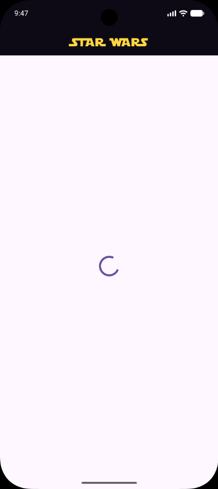
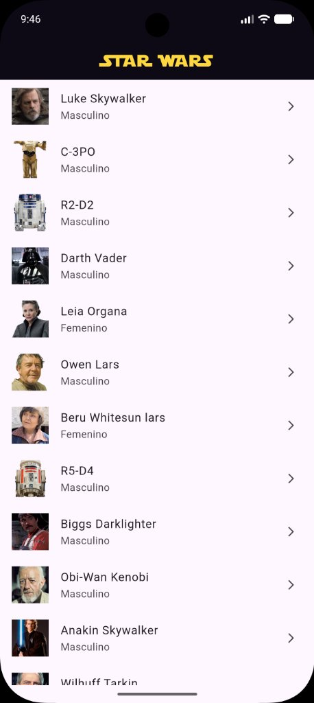
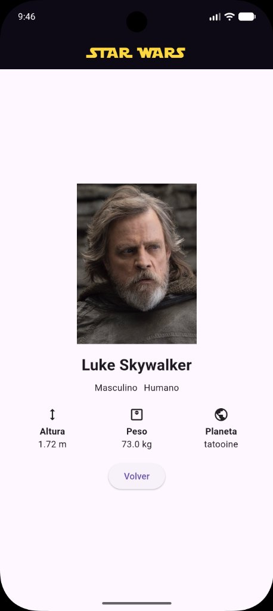
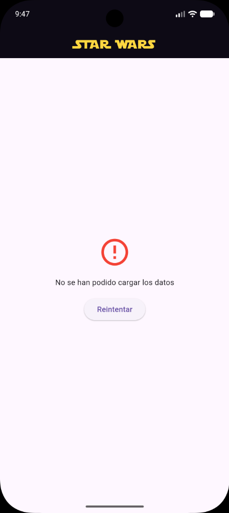

# 🪐 Star Wars App - Práctica Obligatoria (Flutter)

[](https://flutter.dev)
[](https://dart.dev)
[](https://www.todofp.es)

Aplicación móvil desarrollada en **Flutter** para el módulo de **Programación Móvil** (2º DAM - Unidad Didáctica 02).

La app consume la API pública de Star Wars ([`https://akabab.github.io/starwars-api/api/all.json`](https://akabab.github.io/starwars-api/api/all.json)), mostrando los tres estados de red (**Cargando**, **Con datos** y **Error**), permitiendo listar los personajes del universo Star Wars y consultar la ficha completa de cada uno con su foto, datos e indicadores.

---

## 📋 Índice

1. [Capturas de los Tres Estados de la Pantalla](#-capturas-de-los-tres-estados-de-la-pantalla)
2. [Documentación para la Entrega: Catálogo de Widgets y Layout](#-documentación-para-la-entrega-catálogo-de-widgets-y-layout)
3. [Preguntas Clave para la Defensa Oral](#-preguntas-clave-para-la-defensa-oral)
4. [Estructura del Proyecto (`lib/`)](#-estructura-del-proyecto-lib)
5. [Guía Paso a Paso: Descargar desde GitHub y arrancar el proyecto](#-guía-paso-a-paso-descargar-desde-github-y-arrancar-el-proyecto)
6. [Tecnologías y Dependencias](#-tecnologías-y-dependencias)

---

## 📸 Capturas de los Tres Estados de la Pantalla

La aplicación gestiona las tres situaciones posibles de una pantalla que solicita datos por red (`cargando`, `con datos` y `error`) lanzando la petición en `initState()` y actualizando la interfaz mediante `setState()`:

| 1. Estado: Cargando | 2. Estado: Con datos (Lista) | 3. Estado: Con datos (Ficha) | 4. Estado: Error |
| :---: | :---: | :---: | :---: |
| `CircularProgressIndicator` mientras llega la respuesta de la API. | Listado de personajes con foto, nombre y género traducido. | Ficha completa del personaje con foto, datos y 3 indicadores (`Expanded`). | Mensaje claro y botón `Reintentar` al fallar la petición o la URL. |
|  |  |  |  |

---

## 📑 Documentación para la Entrega: Catálogo de Widgets y Layout

> **Requisito de la práctica:**  
> _"Al menos siete distintos, de los del catálogo de la unidad:_  
> _Container, Row, Text, Icon, Padding, Column, Expanded, Image, IconButton, SizedBox, Scaffold, AppBar, TextField, SafeArea, CircleAvatar, ElevatedButton, TextButton, OutlinedButton._  
> _Scaffold y MaterialApp no cuentan: los lleva cualquier app. Cuentan los que has elegido tú para construir tu pantalla."_

---

### 1. Widgets seleccionados del catálogo de la unidad

Se han seleccionado e integrado **11 widgets distintos** del catálogo oficial de la unidad (superando el mínimo de 7 requeridos), sin contar `Scaffold` ni `MaterialApp`:

| # | Widget del Catálogo | Archivo donde se usa | Uso concreto en la pantalla |
| :---: | :--- | :--- | :--- |
| **1** | **`AppBar`** | `home_screen.dart` | Barra superior con fondo negro, elevación y título temático `"STAR WARS"` centrado con fuente `StarJedi`. |
| **2** | **`SafeArea`** | `home_screen.dart` | Envuelve el cuerpo del `Scaffold` para proteger el contenido frente a barras de estado y *notches* del móvil. |
| **3** | **`Image`** (`Image.network`) | `character_tile_widget.dart` / `character_detail_widget.dart` | Carga la foto del personaje desde la red con `BoxFit.cover` y control de imágenes caídas mediante `errorBuilder`. |
| **4** | **`Column`** | `home_screen.dart` / `character_detail_widget.dart` | Organiza verticalmente los elementos del estado de error, de la vista de detalle y de cada indicador. |
| **5** | **`Row`** | `character_detail_widget.dart` | Dispone horizontalmente el género y la especie, así como la fila con los 3 indicadores del personaje. |
| **6** | **`Expanded`** | `character_detail_widget.dart` | Reparte el ancho disponible de la fila de indicadores en **3 partes iguales (1/3 cada uno)** para Altura, Peso y Planeta. |
| **7** | **`Padding`** | `home_screen.dart` / `character_detail_widget.dart` | Añade margen interior de `16px` alrededor de la ficha del personaje y en la pantalla de error. |
| **8** | **`SizedBox`** | `home_screen.dart` / `character_detail_widget.dart` | Espaciador vertical y horizontal para separar bloques visuales (`4px`, `8px`, `10px`, `16px`, `20px`). |
| **9** | **`Text`** | En todas las vistas | Muestra títulos, nombres, géneros/especies traducidos, indicadores y mensajes de error con `TextStyle`. |
| **10** | **`Icon`** | `home_screen.dart` / `character_tile_widget.dart` / `character_detail_widget.dart` | Muestra iconos Material: `Icons.error_outline` (error), `Icons.person` (fallback), `Icons.arrow_forward_ios` y los iconos de indicadores (`Icons.height`, `Icons.monitor_weight_outlined`, `Icons.public`). |
| **11** | **`ElevatedButton`** | `home_screen.dart` | Botón `"Reintentar"` en el estado de error (vuelve a llamar a `cargarDatos()`) y botón `"Volver"` en la ficha de detalle. |

---

### 2. Estructuración del Layout de la Vista

El diseño se organiza desde `HomeScreen` (`StatefulWidget`), que gestiona la petición en `initState()` y los 3 estados, apoyándose en dos widgets `StatelessWidget` propios (`CharacterTile` y `CharacterDetail`):

```text
MaterialApp (Configuración global en main.dart)
 └── HomeScreen (StatefulWidget - Scaffold)
      ├── AppBar (Título "STAR WARS" con fuente StarJedi y color ámbar)
      └── body: SafeArea
           └── Center
                ├── 1. [Si cargando == true]
                │    └── CircularProgressIndicator
                │
                ├── 2. [Si error != null]
                │    └── Padding (16px)
                │         └── Column
                │              ├── Icon(Icons.error_outline, color: Colors.red)
                │              ├── SizedBox(height: 16)
                │              ├── Text("No se han podido cargar los datos")
                │              ├── SizedBox(height: 16)
                │              └── ElevatedButton("Reintentar" -> llama a cargarDatos())
                │
                └── 3. [Con datos (cargando == false && error == null)]
                     │
                     ├── Si personajeAPintar == -1: VISTA LISTA
                     │    └── ListView.builder
                     │         └── GestureDetector (onTap -> personajeAPintar = index)
                     │              └── CharacterTile (StatelessWidget - ListTile)
                     │                   ├── leading: Image.network / Icon(Icons.person)
                     │                   ├── title: Text(nombre)
                     │                   ├── subtitle: Text(género traducido)
                     │                   └── trailing: Icon(Icons.arrow_forward_ios)
                     │
                     └── Si personajeAPintar != -1: VISTA DETALLE (FICHA)
                          └── Column
                               ├── CharacterDetail (StatelessWidget)
                               │    └── Padding (16px)
                               │         └── Column
                               │              ├── Image.network (Foto 250px)
                               │              ├── SizedBox(height: 16)
                               │              ├── Text (Nombre en 24px negrita)
                               │              ├── SizedBox(height: 8)
                               │              ├── Row (Género + SizedBox + Especie)
                               │              ├── SizedBox(height: 20)
                               │              └── Row (Indicadores de la ficha)
                               │                   ├── Expanded -> Column (Icon + "Altura" + valor m)
                               │                   ├── Expanded -> Column (Icon + "Peso" + valor kg)
                               │                   └── Expanded -> Column (Icon + "Planeta" + valor)
                               └── ElevatedButton ("Volver" -> personajeAPintar = -1)
```

---

## 🎤 Preguntas Clave para la Defensa Oral

1. **¿Por qué `HomeScreen` es `StatefulWidget` y no `StatelessWidget`?**  
   Porque su contenido cambia a lo largo de la vida de la pantalla: empieza mostrando el estado de carga (`cargando = true`), luego cambia cuando llegan los datos de la API (`lista`) o si ocurre un fallo (`error`), y también cambia cuando el usuario pulsa un personaje para ver su ficha (`personajeAPintar`). En cambio, `CharacterTile` y `CharacterDetail` son `StatelessWidget` porque solo reciben un objeto `Character` ya construido y lo pintan sin modificar ningún estado interno.

2. **¿Qué pasaría si quitas el `setState()`?**  
   Las variables en memoria (`cargando`, `lista`, `error`, `personajeAPintar`) cambiarían su valor, pero Flutter no se enteraría de que tiene que volver a ejecutar el método `build()`. La pantalla se quedaría congelada eternamente en el estado inicial mostrando el `CircularProgressIndicator`.

3. **¿Dónde se lanza la petición HTTP y por qué ahí (`initState` vs `build`)?**  
   Se lanza dentro de `initState()` llamando a `cargarDatos()`. Se hace ahí porque `initState()` se ejecuta **una única vez** cuando el widget se crea e inserta en el árbol. Si pusiéramos la petición dentro de `build()`, cada vez que Flutter repintase la pantalla (por ejemplo, al hacer `setState`), se volvería a disparar la petición HTTP en bucle haciendo cientos de llamadas a la API.

4. **¿Qué widget elegiste para repartir el espacio y por qué ese?**  
   Elegí `Expanded` dentro de la fila (`Row`) de los tres indicadores de la ficha (`character_detail_widget.dart`: Altura, Peso y Planeta). Al envolver cada una de las 3 columnas en un `Expanded`, obligamos a Flutter a repartir el ancho disponible de la fila en **3 partes iguales (1/3 para cada indicador)**, adaptándose a cualquier ancho de móvil y evitando que un nombre de planeta largo provoque un desbordamiento (*overflow*).

5. **¿Cómo se provoca y gestiona el estado de error?**  
   En `CharacterService.getAllCharacters()` comprobamos `if (response.statusCode != 200)` antes de decodificar el JSON y lanzamos una excepción. En `HomeScreen.cargarDatos()`, envolvemos la llamada en un bloque `try / catch`: si la URL está mal escrita (por ejemplo, cambiando `all.json` por `all_error.json`) o no hay conexión, entra en el `catch`, asigna `error = 'No se han podido cargar los datos'` y `cargando = false` dentro de `setState()`, mostrando el aviso con el botón **Reintentar**.

---

## 📁 Estructura del Proyecto (`lib/`)

El código fuente sigue la organización por capas y la convención de nombres `nombre_[nombre_carpeta].dart`:

```text
lib/
├── main.dart                               # Punto de entrada (MaterialApp)
├── models/
│   └── character_model.dart                # Clase Character con su factory Character.fromJson
├── services/
│   └── character_service.dart              # Petición HTTP con paquete http y control de statusCode
├── presentation/
│   ├── screens/
│   │   └── home_screen.dart                # Pantalla principal (StatefulWidget: initState, setState y 3 estados)
│   └── widgets/
│       ├── character_tile_widget.dart      # Fila individual del listado (StatelessWidget)
│       └── character_detail_widget.dart    # Ficha de detalle con datos e indicadores (StatelessWidget)
└── utils/
    └── traducciones_utils.dart             # Funciones auxiliares de traducción al español
```

---

## 📥 Guía Paso a Paso: Descargar desde GitHub y arrancar el proyecto

### Paso 1: Descargar el proyecto desde GitHub
1. Entra en el enlace del repositorio en tu navegador web.
2. Haz clic en el botón verde **`<> Code`** y selecciona **`Download ZIP`**.
3. Extrae el archivo `.zip` en tu ordenador.

### Paso 2: Abrir en Visual Studio Code y descargar paquetes
1. Abre **Visual Studio Code** y selecciona **`Archivo` ➔ `Abrir carpeta...`** eligiendo la carpeta `practica_obligatoria`.
2. Cuando aparezca el aviso para instalar paquetes, pulsa **`Get Packages`** (o abre `pubspec.yaml` y pulsa el icono de descarga arriba a la derecha).

### Paso 3: Ejecutar en el emulador
1. Selecciona tu emulador Android o dispositivo en la esquina inferior derecha de la barra de estado de VS Code.
2. Pulsa **`F5`** (o **`Ejecutar` ➔ `Iniciar depuración`**) para compilar y lanzar la aplicación.

---

## 🛠️ Tecnologías y Dependencias

- **Flutter SDK**: `^3.10.0`
- **Dependencias**:
  - [`http`](https://pub.dev/packages/http): Peticiones HTTP a la API REST.
- **Recursos locales (`assets/`)**:
  - `assets/fonts/Starjedi.ttf`: Fuente temática configurada en `pubspec.yaml`.

---

## 👨‍💻 Información Académica

- **Ciclo formativo**: 2º DAM (Desarrollo de Aplicaciones Multiplataforma).
- **Módulo**: Programación Móvil.
- **Unidad**: UD02 - Flutter.
